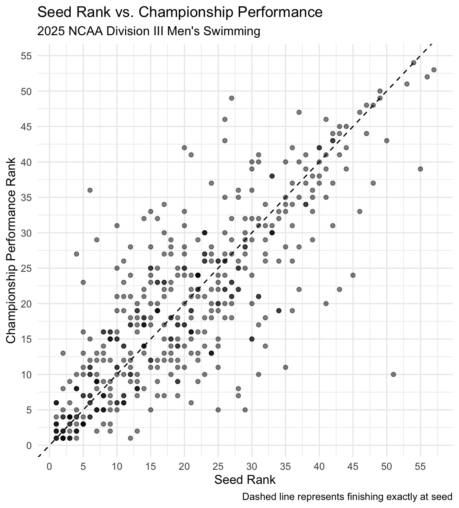
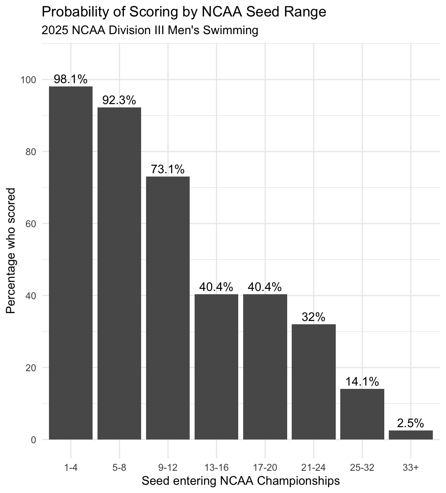
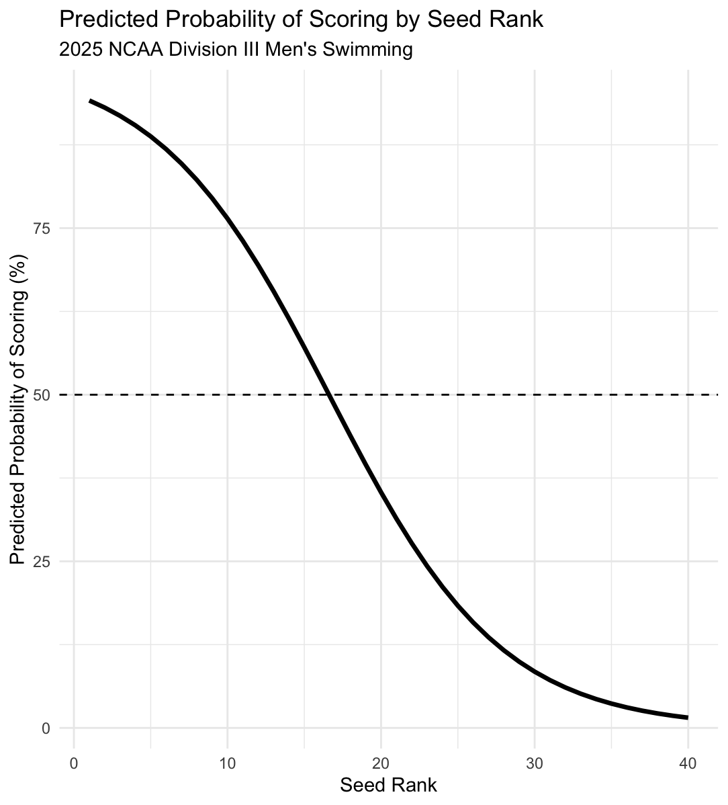
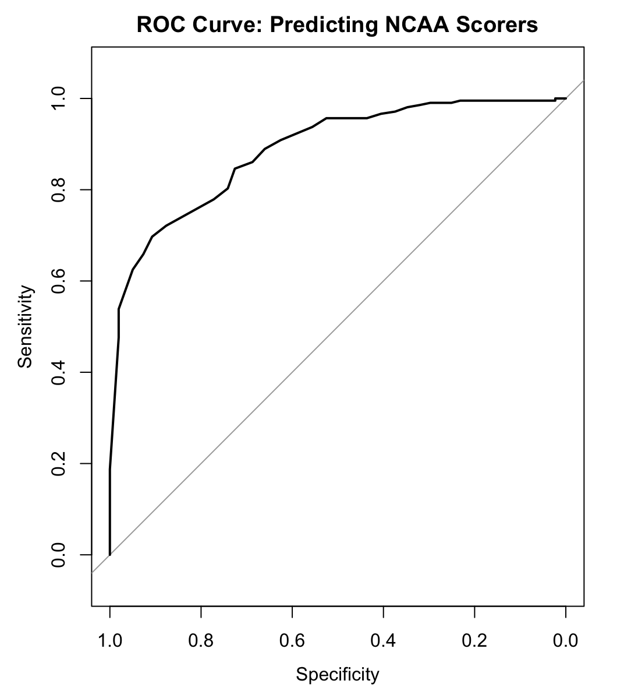

# NCAA Division III Swimming: Does Seed Rank Predict Who Scores?

How well do pre-meet seed rankings predict what actually happens at a national championship? This project analyzes **467 swimmer-event performances** across all 13 individual events at the **2025 NCAA Division III Men's Swimming & Diving Championships** to find out.

**Tools:** R · tidyverse · pROC · Quarto
**Methods:** Spearman correlation · logistic regression · classification metrics · threshold analysis · ROC/AUC

📊 **[Read the full write-up on my portfolio →](https://ben-bevill05.github.io/swimming.html)**

---

## Questions

1. How strongly does seed rank predict championship finish?
2. How does performance relative to seed vary across events?
3. How accurately can seed rank predict whether a swimmer will score (finish top 16)?

## Key Findings

| Finding | Result |
|---|---|
| Seed rank vs. championship finish (Spearman ρ) | **0.797** (p < 0.001) |
| Average places finished away from seed | **5.51** (median 4) |
| Finished within 5 places of seed | **64.1%** |
| Top-16 seeds who actually scored | **76.0%** (158 of 208) |
| Scoring spots earned by swimmers seeded outside the top 16 | **24.0%** (50 of 208) |
| Logistic regression accuracy (50% threshold) | **78.6%** |
| AUC | **0.887** |

- **Swimmers were 0.326% slower than their seed times on average.** The 50 Free was the only event where the field got faster.
- **The scoring line is blurry.** Seeds 13–16 and 17–20 scored at the *same* 40.4% rate.
- **The model's 50% scoring probability falls at seed 16–17**, almost exactly at the NCAA's 16-place scoring cutoff.
- The **100 Fly** was the most predictable event (ρ = 0.881). The **500 Free** was the least predictable (ρ = 0.673).

## Visuals

<p align="center">
  
  
</p>
<p align="center">
  
  
</p>

## Approach

1. **Standardized performance.** The 1650 Free is a timed final, while other events use prelims and finals. I built a single `performance_time` and `performance_rank` so every event could be compared on equal terms.
2. **Measured seed accuracy.** I used Spearman rank correlation (both variables are rankings) and absolute rank error, both overall and by event.
3. **Defined scoring.** A swimmer scored if they finished in the top 16 (A or B final).
4. **Modeled scoring probability.** I fit a logistic regression of `scored ~ seed_rank`. Each one-place drop in seed was associated with a **~16.3% decrease in the odds of scoring**.
5. **Evaluated the model.** I built a confusion matrix, computed accuracy, precision, recall and specificity across thresholds from 0.1 to 0.9, and plotted the ROC curve and AUC.

## Limitations

- The analysis covers **one championship (2025)** only, so patterns may not hold across seasons.
- The model was trained and evaluated on the **same data**. Its accuracy describes fit to 2025, not validated predictive performance on future meets.
- A natural next step is to add multiple seasons and test on held-out championships.

## Repository Structure

```
├── analysis/
│   └── ncaa_swimming_analysis.qmd   # Full analysis (Quarto)
├── data/
│   └── 2025_mens_all_events.csv     # Swimmer-event results
├── images/                          # Figures used above
└── README.md
```

## Reproduce

1. Clone the repo and open `ncaa-diii-swimming-analysis.Rproj` in RStudio.
2. Install the packages: `install.packages(c("tidyverse", "pROC", "here"))`
3. Render the report: `quarto render analysis/ncaa_swimming_analysis.qmd`

---

**Ben Bevill** · Data Analytics, Denison University · [Portfolio](https://ben-bevill05.github.io/) · [LinkedIn](https://www.linkedin.com/in/ben-bevill-5a9190331/)
